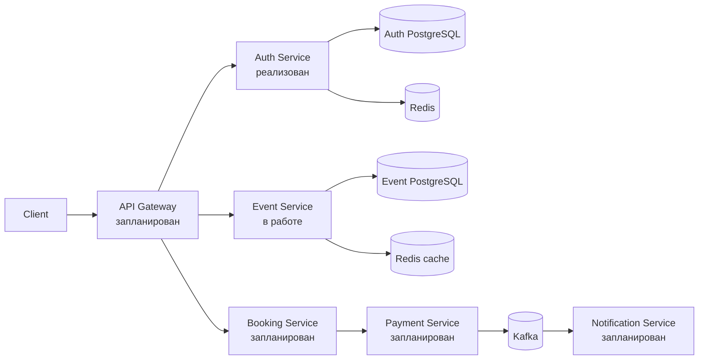

# Ticket Platform

Платформа бронирования билетов на мероприятия, которую я развиваю как
production-minded микросервисный проект на Go.

Цель проекта — не собрать набор независимых CRUD-сервисов, а последовательно
проработать задачи, которые возникают в реальных распределённых системах:
безопасную аутентификацию, конкурентный доступ к данным, идемпотентность,
сервисные границы, кеширование, асинхронные события и наблюдаемость.

> **Текущий статус:** проект находится в активной разработке. Auth Service
> реализован и запускается через Docker Compose. Для Event Service подготовлена
> и проверяется схема БД; остальные сервисы относятся к roadmap и пока не
> выдаются за готовую функциональность.

## Текущий статус компонентов

| Компонент | Статус | Что есть сейчас |
| --- | --- | --- |
| Auth Service | ✅ Реализован | Регистрация, login, JWT/JWKS, refresh rotation, reuse detection, logout, Redis rate limit |
| Event Service | 🚧 В работе | Миграция каталога: площадки, мероприятия и ценовые зоны |
| API Gateway | 📋 Запланирован | Проксирование и проверка JWT по JWKS |
| Booking Service | 📋 Запланирован | Резервы с TTL, защита от oversell, saga |
| Payment Service | 📋 Запланирован | Идемпотентность и transactional outbox |
| Notification Service | 📋 Запланирован | Kafka consumer, retry/backoff и DLQ |

## Целевая архитектура (реализована частично)

Фактически сейчас реализованный контур выглядит так:

```text
Client → Auth Service → PostgreSQL
                      → Redis
```

Целевое состояние платформы:



Каждый сервис должен владеть своей БД. Межсервисные внешние ключи не
используются: основные синхронные внутренние вызовы планируются по gRPC, а
асинхронные события — через Kafka.

## Что уже реализовано

### Auth Service

HTTP-сервис регистрации и аутентификации пользователей:

- регистрация с нормализацией email и bcrypt-хешированием пароля;
- уникальность email без учёта регистра на уровне PostgreSQL;
- единая ошибка для неизвестного email и неверного пароля;
- dummy bcrypt для уменьшения timing-сигнала при user enumeration;
- access JWT с подписью Ed25519/EdDSA и claims `sub`, `role`, `iat`, `exp`,
  `jti`;
- issuer задаётся через `AUTH_ISSUER` и включается в claim `iss`;
- JWKS endpoint для проверки JWT без передачи приватного ключа;
- opaque refresh-токены с 256 битами энтропии;
- хранение в БД только SHA-256-хеша refresh-токена;
- атомарная ротация refresh-токенов и reuse detection;
- отзыв всех активных refresh-токенов пользователя, если ещё не истёкший
  ротированный токен повторно используют вне grace window;
- роли `user`, `moderator`, `admin` заложены в БД и JWT как основа будущей
  авторизации.

### HTTP API

| Метод | Endpoint | Назначение |
| --- | --- | --- |
| `POST` | `/register` | Регистрация пользователя |
| `POST` | `/login` | Получение access и refresh-токенов |
| `POST` | `/refresh` | Ротация refresh-токена |
| `POST` | `/logout` | Отзыв refresh-токена |
| `GET` | `/.well-known/jwks.json` | Публичный ключ в формате JWKS |
| `GET` | `/healthz` | Liveness-проверка процесса |

### Атомарная ротация refresh-токенов

Refresh-токен используется как одноразовый. Репозиторий сначала атомарно
захватывает только живой и ещё не отозванный токен:

```sql
UPDATE refresh_tokens
SET revoked_at = clock_timestamp()
WHERE token_hash = $1
  AND revoked_at IS NULL
  AND expires_at > now()
RETURNING id, user_id;
```

Затем в той же транзакции создаётся новый токен, а старый связывается с ним
через `replaced_by_token_id`. В отличие от схемы `SELECT` → `UPDATE`, два
конкурирующих запроса не могут одновременно успешно ротировать один токен.

Короткое grace window отделяет вероятную клиентскую гонку от повторного
использования украденного токена. Если ещё не истёкший ротированный токен
повторно используют после окончания окна, reuse считается компрометацией и
приводит к отзыву всех активных refresh-токенов пользователя. Клиент при этом
не получает деталей внутреннего состояния токена.

### Распределённый rate limiting

Login ограничивается одновременно по IP и нормализованному email. Для этого
реализован sliding-window log на Redis ZSET и Lua:

- очистка окна, подсчёт и добавление запроса выполняются атомарно;
- время берётся через Redis `TIME`, а не с часов приложения;
- UUID используется как member, поэтому параллельные запросы не схлопываются;
- email хешируется перед использованием в Redis-ключе;
- отклонённый запрос не продлевает блокировку;
- после успешного login сбрасывается только email-bucket, но не IP-bucket;
- при недоступности Redis выбрана политика fail-open с записью ошибки в лог.

### Архитектура и эксплуатационные основы

Auth Service построен по слоям:

```text
HTTP handler → application service → repository → PostgreSQL
                         ├──────────→ token service
                         └──────────→ Redis rate limiter
```

- зависимости передаются через конструкторы;
- интерфейсы объявлены на стороне потребителей;
- доменные ошибки отделены от ошибок PostgreSQL и HTTP;
- `context.Context` проходит по I/O-цепочке HTTP → service →
  PostgreSQL/Redis;
- используется JSON-логирование через `slog` и `request_id`;
- настроены HTTP timeouts, panic recovery и graceful shutdown;
- миграции выполняются отдельным контейнером;
- Docker image собирается в несколько стадий и запускается не от root;
- приватный Ed25519-ключ не попадает в image и монтируется read-only;
- `.env` и PEM-ключи исключены из Git.

### Текущие ограничения Auth Service

- JWKS публикует один активный signing key; бесшовная ротация ключей пока не
  реализована;
- logout отзывает refresh-токен, но уже выданный stateless access JWT действует
  до окончания своего короткого TTL;
- IP для rate limiting берётся из `RemoteAddr`; после появления Gateway будет
  нужна явная политика доверенных proxy и обработки forwarded-заголовков;
- `/healthz` проверяет жизнь процесса, но пока не готовность PostgreSQL и Redis;
- интеграционные тесты с реальным PostgreSQL, Testcontainers и CI вынесены в
  roadmap.

## Event Service: текущая работа

На текущем этапе проектируется каталог. Подготовлена миграция из трёх таблиц:

- `venues` — площадки и IANA timezone;
- `events` — мероприятия, время, статус публикации и soft delete;
- `event_zones` — вместимость, цена в минимальных денежных единицах и валюта.

В схеме уже прорабатываются:

- `TIMESTAMPTZ` для абсолютного момента времени;
- валидация IANA timezone через PostgreSQL;
- хранение денег в `bigint`, без `float`;
- ограничения для цены, вместимости, валюты и времени окончания;
- различие между бизнес-отменой и административным удалением;
- индекс `(starts_at, id)` под будущую keyset pagination;
- автоматическое обновление `updated_at` триггером БД.

Это пока именно схема данных: Go-приложение Event Service, HTTP API и
cache-aside ещё не реализованы.

## Технологии

| Область | Технологии |
| --- | --- |
| Язык | Go 1.26.1 |
| HTTP | `net/http`, `chi` |
| База данных | PostgreSQL 17, `pgx` |
| Redis | Redis 8, Lua, `go-redis` |
| Аутентификация | Ed25519, JWT, JWKS, bcrypt, opaque refresh tokens |
| Логирование | `log/slog`, JSON, request ID |
| Тестирование | `testing`, `testify`, `httptest`, `miniredis`, race detector |
| Инфраструктура | Docker, Docker Compose, multi-stage build |

## Структура репозитория

```text
.
├── services/
│   ├── auth/
│   │   ├── cmd/auth/                 # composition root и HTTP-сервер
│   │   ├── cmd/genkeys/              # генератор Ed25519 key pair
│   │   ├── internal/config/          # конфигурация из environment
│   │   ├── internal/domain/          # доменные модели и ошибки
│   │   ├── internal/handler/         # HTTP handlers и middleware
│   │   ├── internal/logger/          # structured logging
│   │   ├── internal/ratelimit/       # Redis + Lua rate limiter
│   │   ├── internal/repository/      # PostgreSQL repositories
│   │   ├── internal/service/         # сценарии приложения
│   │   ├── internal/token/           # JWT, refresh tokens и JWKS
│   │   └── migrations/               # Auth migrations
│   └── event/
│       └── migrations/               # схема каталога в разработке
├── docker-compose.yaml
└── README.md
```

Auth изолирован собственным `go.mod`. Каждый новый runnable-сервис также будет
получать отдельный Go-модуль; общий пакет и workspace сознательно отложены до
появления нескольких реализованных сервисов.

## Локальный запуск

Требования:

- Go 1.26.1;
- Docker с Docker Compose.

### 1. Сгенерировать ключи Auth Service

Команда предназначена для первого запуска, когда каталога
`services/auth/keys` ещё нет:

```bash
go -C services/auth run ./cmd/genkeys -out ./keys
```

`kid` вычисляется приложением автоматически; отдельная переменная
`AUTH_KEY_ID` не требуется.

### 2. Создать `.env` в корне проекта

Минимальная конфигурация для локального Docker Compose:

```dotenv
HTTP_PORT=8080

DB_HOST=postgres
DB_PORT=5432
DB_USER=ticket
DB_PASSWORD=change-me
DB_NAME=ticket_platform
DB_SSLMODE=disable

AUTH_ISSUER=ticket-platform-auth
REDIS_ADDRESS=redis:6379
```

TTL токенов, Redis timeouts и лимиты login имеют значения по умолчанию и при
необходимости переопределяются environment-переменными.

### 3. Запустить сервис

```bash
docker compose config --quiet
docker compose up --build -d
docker compose ps --all
```

Проверка:

```bash
curl --retry 10 --retry-connrefused --retry-delay 1 -fsS \
  http://localhost:8080/healthz
curl -fsS http://localhost:8080/.well-known/jwks.json
```

Логи Auth Service:

```bash
docker compose logs -f ticket-platform-auth
```

Остановка:

```bash
docker compose down
```

## Проверка кода

Команды запускаются из корня репозитория:

```bash
go -C services/auth mod tidy -diff
go -C services/auth build ./...
go -C services/auth vet ./...
go -C services/auth test -race ./...
```

Основная бизнес-логика покрыта unit-тестами, HTTP-тестами через `httptest` и
тестами Redis-сценариев через `miniredis`. Проверяются JWT/JWKS, состояния
refresh-токенов, ошибки HTTP API, ограничения rate limiter, IPv6 и поведение
при недоступном Redis. Интеграционные тесты с реальным PostgreSQL запланированы
через Testcontainers.

## Roadmap

### Этап 1 — Auth Service ✅

- каркас монорепозитория и Docker Compose;
- регистрация и login;
- Ed25519 JWT и JWKS;
- refresh rotation, reuse detection и logout;
- Redis rate limit по IP и email;
- unit-тесты и race detector.

### Этап 2 — Event Service и API Gateway 🚧

- завершить схему БД каталога;
- собрать каркас Event Service с отдельным PostgreSQL;
- реализовать CRUD мероприятий и ценовых зон;
- добавить видимость каталога по ролям;
- реализовать Redis cache-aside: TTL, invalidation, negative caching,
  stampede protection и защиту от stale write после invalidation;
- собрать минимальный API Gateway;
- валидировать JWT по JWKS с проверкой `alg`, `iss`, `exp` и `kid`;
- кешировать JWKS и передавать вниз `sub`/`role`.

### Этап 3 — Booking Service 📋

- резервирование мест с TTL;
- защита от oversell;
- сравнение `SELECT FOR UPDATE` и optimistic locking на бенчмарке;
- saga бронирование → оплата → подтверждение.

### Этап 4 — Kafka, Payment и Notification 📋

- идемпотентность Payment по `Idempotency-Key`;
- transactional outbox;
- Kafka consumer groups;
- retry с backoff и DLQ для уведомлений.

### Этап 5 — внутренние контракты и observability 📋

- gRPC между сервисами;
- Prometheus;
- OpenTelemetry и Jaeger;
- интеграционные тесты через Testcontainers;
- CI в GitHub Actions;
- фоновая пакетная чистка просроченных refresh-токенов.

## Что демонстрирует проект

- проектирование границ микросервисов и владения данными;
- защиту auth-сценариев и управление жизненным циклом токенов;
- понимание race conditions и атомарных операций;
- осознанный выбор между consistency, security и availability;
- применение ограничений БД вместо проверки только в application-коде;
- тестируемую слоистую архитектуру без преждевременного общего framework;
- умение явно фиксировать trade-offs и возвращаться к отложенным решениям по
  мере роста системы.

Проект развивается итеративно: каждая следующая инфраструктурная тема
добавляется тогда, когда для неё появляется реальный сценарий, а не ради
формального присутствия технологии в списке.
